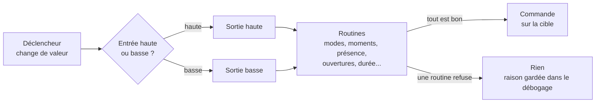

# Scènes

Une scène pilote **une entité cible** (une lumière, un volet, une serrure, un chauffe-eau, un thermostat, une ventilation...) à partir d'une ou plusieurs **entités déclencheurs** (un détecteur de mouvement, une porte, une télécommande, le jour / la nuit...). Entre les deux, une suite de **routines** décide si l'ordre part ou non.

## Les déclencheurs

Pour chaque déclencheur, on choisit :

- la **valeur d'entrée haute** et la **valeur d'entrée basse** (ex : `1` et `0` pour un détecteur, des seuils pour une température) ;
- la **sortie** correspondante : niveau haut, niveau bas, inverser, ou aucune.

Entre les deux seuils, il ne se passe rien : c'est une hystérésis, qui évite qu'une valeur qui oscille fasse clignoter la cible. Les seuils peuvent être des nombres, des heures (`hhmm`) ou des textes, et une liste propose ses options.

Les modes de la source `dknr` peuvent servir de déclencheurs. Par exemple, `dknr/sensor/nycthemer` (jour / nuit) déclenche une scène au lever et au coucher du soleil. Voir [Modes de la maison](modes.md).

## Les routines

Les routines proposées dépendent de l'élément de la cible. Elles s'appliquent dans cet ordre :

| Routine | Effet |
| --- | --- |
| **Modes** | Rien si l'automatisme général est arrêté, si la scène est désactivée ou si l'élément est en mode manuel. |
| **Moments** | Uniquement la nuit, ou le jour, aux heures de confort ou d'éco de la pièce. |
| **Luminosité** | Uniquement s'il fait assez sombre, ou assez clair. |
| **Présence** | Allume sur mouvement et maintient tant que le mouvement continue (rétention). |
| **Ouvertures** | Rien tant qu'une porte, une fenêtre ou une baie déclencheur est ouverte. L'ordre bloqué est rejoué quand la dernière se ferme. |
| **Humidité**, **veilleuse** | Selon le taux d'humidité, ou un niveau réduit la nuit. |
| **Tarif** | Uniquement quand le tarif est favorable (heures creuses). |
| **Puissance** | Arrête quand l'appareil ne consomme plus (puissance sous le seuil bas pendant 10 s). |
| **Quotidien** | Une seule fois par jour. Remis à zéro chaque matin à 8 h, et depuis la page Configuration. |
| **Durée** | Arrête automatiquement après un délai, y compris après un allumage à la main. |
| **Thermostat** | Consigne confort, éco ou hors gel, sondes intérieures et extérieures, durée de chauffe calculée, arrêt fenêtre ouverte, refroidissement sur énergie solaire. Réévalué chaque minute. |

!!! info "Les routines liées à l'heure"
    Les moments (jour, nuit, confort, éco, veilleuse) ne sont réévalués que lorsqu'un déclencheur change. Pour qu'une scène suive le jour et la nuit, ajoutez `dknr/sensor/nycthemer` à ses déclencheurs.

## Comprendre ce qu'a fait une scène

Le détail d'une scène, dans la page **Scènes**, contient un tableau **Débogage** : pour chaque passage, la routine qui a arrêté l'ordre et pourquoi (ouverture ouverte, mode manuel, pas assez sombre, déjà fait aujourd'hui...). C'est le premier endroit où regarder quand une scène ne fait pas ce qu'on attend.

La page liste aussi les **minuteurs** en cours (routine *durée*), qu'on peut arrêter, et les derniers **événements**.

## Exemples

=== "Lumière sur mouvement"

    - **Cible** : la lumière du couloir.
    - **Déclencheur** : le détecteur de mouvement, entrée haute `1` → sortie haute.
    - **Routines** : présence, nuit (ou luminosité), durée 2 minutes.

    La lumière s'allume au passage la nuit et s'éteint 2 minutes après le dernier mouvement.

=== "Volets au coucher du soleil"

    - **Cible** : le volet du salon.
    - **Déclencheur** : `dknr/sensor/nycthemer`, jour → sortie haute, nuit → sortie basse.
    - **Routines** : modes (pour respecter le mode manuel des volets), ouvertures avec la baie vitrée en déclencheur.

    Les volets s'ouvrent au lever du soleil et se ferment à son coucher, sauf si la baie est ouverte : la fermeture attend qu'elle soit refermée.

=== "Chauffage d'une pièce"

    - **Cible** : le thermostat ou la vanne de la chambre.
    - **Déclencheur** : la sonde de température de la chambre.
    - **Routines** : thermostat (consignes confort et éco), ouvertures avec la fenêtre en déclencheur.

    La consigne suit les heures de confort de la pièce et le chauffage s'arrête quand la fenêtre est ouverte.

=== "Chauffe-eau en heures creuses"

    - **Cible** : la prise du chauffe-eau.
    - **Déclencheur** : l'entité de tarif.
    - **Routines** : tarif, quotidien, puissance (arrêt quand l'eau est chaude).

    Le chauffe-eau chauffe une fois par jour en heures creuses et se coupe dès qu'il ne consomme plus.
