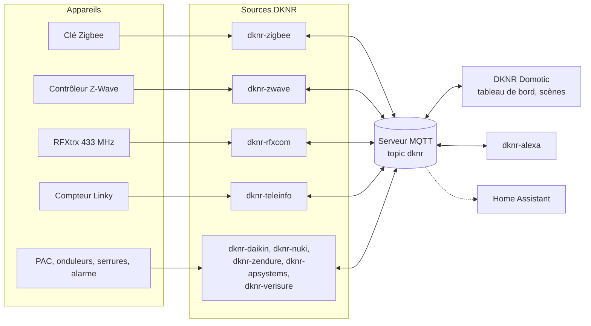

# DKNR Domotic

**Une domotique locale, sans cloud, construite avec Node-RED, MQTT et Docker.**

Chaque projet DKNR parle directement à un type d'appareil sur votre réseau local (clé Zigbee, contrôleur Z-Wave, compteur Linky, pompe à chaleur, serrure...) et publie des valeurs simples sur un serveur MQTT partagé. **DKNR Domotic** réunit ensuite toutes ces entités dans un même tableau de bord, les range par pièce, garde leur historique et les pilote par des scènes.

[Bien démarrer](demarrer/index.md){ .md-button .md-button--primary }
[Voir les projets](#les-projets){ .md-button }

## Comment ça marche

1. **Les sources** traduisent chaque appareil en *entités* : une température, un état allumé / éteint, une position de volet...
2. Elles publient ces entités sur le **serveur MQTT**, toutes au même [format DKNR](demarrer/format-dknr.md) : `dknr/get/<source>/<appareil>/<entité>` pour lire, `dknr/set/...` pour piloter.
3. **DKNR Domotic** découvre automatiquement les entités, les affiche par pièce, les historise et les pilote par des scènes. D'autres projets, comme **dknr-alexa**, lisent et pilotent les mêmes entités.
4. En option, les sources publient aussi la **discovery Home Assistant** : vos appareils apparaissent dans Home Assistant sans configuration.

## Les principes

- **Local d'abord** : aucun projet ne dépend du cloud d'un fabricant (sauf Zendure, dont l'API passe par son serveur MQTT, et Verisure, qui n'offre aucun accès local). Tout continue de fonctionner sans internet.
- **Un projet par technologie** : chaque source est un conteneur Docker indépendant. Vous n'installez que ce dont vous avez besoin, et une panne reste isolée.
- **Un format commun** : toutes les sources publient de la même façon. Un binaire vaut toujours `1` ou `0`, une liste publie toujours la clé de l'option.
- **Node-RED partout** : chaque projet est un flow Node-RED en mode projet, avec son propre tableau de bord et un éditeur pour les curieux.

## Les projets

| Projet | Rôle |
| --- | --- |
| [DKNR Domotic](domotic/index.md) | Le tableau de bord et le cerveau : pièces, énergie, scènes, modes, utilisateurs |
| [dknr-zigbee](sources/zigbee.md) | Appareils Zigbee, via Zigbee2MQTT |
| [dknr-zwave](sources/zwave.md) | Appareils Z-Wave, via Z-Wave JS UI |
| [dknr-rfxcom](sources/rfxcom.md) | Appareils radio 433 MHz reçus par un RFXCom RFXtrx433 |
| [dknr-teleinfo](sources/teleinfo.md) | Téléinformation (TIC) du compteur électrique |
| [dknr-nuki](sources/nuki.md) | Serrures et Opener Nuki, par l'API locale du bridge |
| [dknr-daikin](sources/daikin.md) | Pompes à chaleur Daikin, par l'API locale |
| [dknr-zendure](sources/zendure.md) | Onduleurs et batteries Zendure |
| [dknr-apsystems](sources/apsystems.md) | Onduleurs solaires APSystems, par l'API locale de l'ECU |
| [dknr-verisure](sources/verisure.md) | Alarme Verisure France, par le cloud Verisure |
| [dknr-alexa](integrations/alexa.md) | Partage des entités vers et depuis Amazon Alexa |

Les images Docker sont publiées sur [Docker Hub](https://hub.docker.com/u/jcpd) et dans les [packages de l'organisation](https://github.com/orgs/dknr-domotic/packages), pour les architectures amd64 et arm64 (Raspberry Pi compris).
